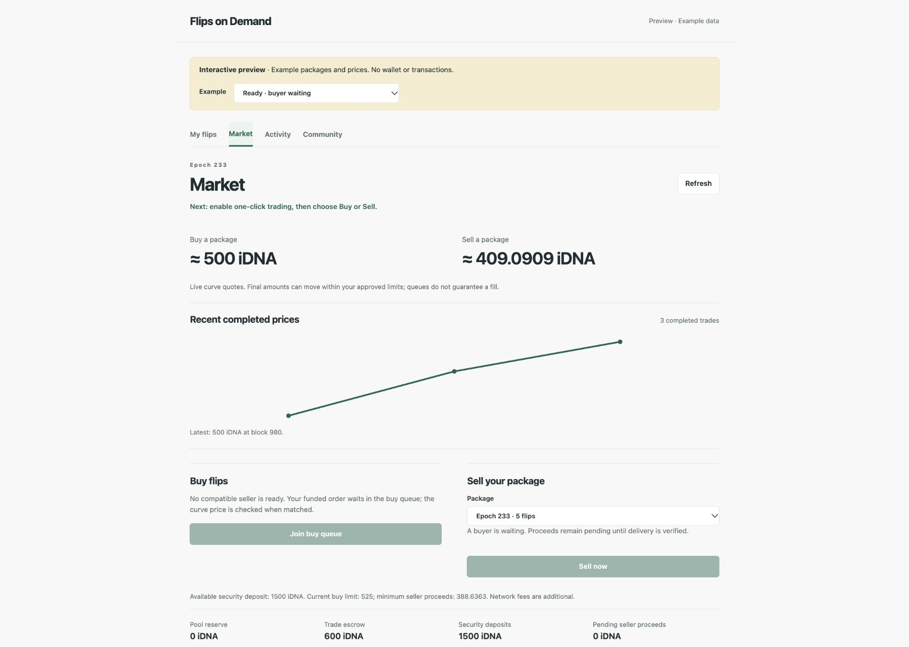

# Flips on Demand

An experimental market for access to historical Idena picture puzzles (*flips*). An author can offer a validated set from one epoch; a buyer can unlock and check the original pictures. A future CAPTCHA service could use those puzzles on a website. That service is not part of this repository.



*Standalone v9 preview with synthetic data. These are not live offers, trades or prices.*

## Try the interface

The standalone browser preview runs on your computer. It needs no IdenaAI installation, node, wallet, keys or funds, and it cannot send transactions. Choose an example at the top to explore a waiting buyer, funded trade or completed purchase.

After [building `fod`](#build-the-cli), run from `tools/fod`:

```bash
./fod app-v9 -read-only-preview
```

The command opens a local browser page. Add `-no-browser` to print its URL instead. The examples are synthetic, including their flip pictures and balances.

## How a real purchase works

1. **Seller prepares a set.** The local client checks the original encrypted flips, their author and CIDs, and the canonical validation result. The seller keeps the unlocking keys in an encrypted local vault and posts a reusable security deposit before offering the set.
2. **Buyer joins the queue.** The buyer posts separate purchase escrow and security collateral. The market matches compatible buy and sell orders at its current curve quote. A set starts at a 500 iDNA buy quote only in the empty reference market; the live quote, collateral and network fees must be checked before trading.
3. **Keys are delivered and checked.** The buyer retains the original encrypted flips. After the buyer signals readiness, the seller encrypts the keys for that buyer and posts the ciphertext to the contract. The buyer's local client decrypts it, opens every original flip, saves an encrypted local copy and accepts only after verification. Normal v9 sales need no upfront content proof; disputed delivery needs separate proofs.
4. **Buyer views the set.** A completed purchase appears under **My flips**, where the buyer can preview the original picture sequences or save an encrypted package.

The ciphertext is visible on chain, but only the buyer's separate delivery key can open it. The market does not send an idena.social message. Access to keys is copyable and is not exclusive; historical human agreement does not guarantee that a puzzle resists AI.

## Sell your flip set

Only the author can sell their own validated set from one epoch (1–32 flips). The package is built from the original encrypted flips and their CIDs, the keys that open them, and a canonical validation-session record. A ZIP of pictures or a list of CIDs alone cannot be listed.


In the live client, **My flips → Collect & check** fetches and CID-checks your node's original flips. **Protect package** opens them with your identity locally and saves their keys in a password-encrypted vault. Import the matching canonical session under **Add saved validation evidence → Verify & add**, or connect an existing capture archive. Once the set is ready, fund a reusable security deposit and choose **Market → Sell your package → Join sell queue**. The v9 `queueSell` transaction binds the verified inventory and session while reserving collateral; it needs no upfront proof registration. A queued offer is not yet a sale.

After a compatible buyer order matches, the buyer first confirms that the encrypted flip files are available. Your client then encrypts the opening keys for that buyer and delivers the ciphertext through the contract. The buyer opens every original flip and accepts the valid delivery to release your proceeds. Keep your app, node and private vault available through delivery; do not send keys through idena.social. For capture setup, signing boundaries, matching, expiry and dispute steps, use the [v9 seller guide](docs/SELLER_GUIDE_V9.md).

## Connect to the live market

The standalone client does **not** require IdenaAI. Real trading currently requires a compatible, synced Idena node with authenticated loopback RPC, independently verified v9 contract and code pins, and an owner-only local identity key for signing. An app.idena.io login alone is not a connection to this client. Follow the [standalone setup and safety steps](docs/STANDALONE_V8.md#connect-once), using `app-v9` and a separate v9 profile as explained in the [v9 guide](docs/OPTIMISTIC_BONDED_MARKET_V9.md#standalone-preview).

Buy and sell orders start with the owner's action. Matching and delivery can continue locally while an approved, bounded trading session is active and the app and node are running. Deposits, withdrawals, disputes and proof generation require separate review. A stalled or uncertain transaction must be reconciled before another is sent.

## Pilot status and limits

The v9 contract has a recorded, deployed common-operator pilot: two five-flip purchases settled on 25 October 2026. That record does not establish independent demand, a current live quote, successful trading between unrelated operators or an external security audit. Funded refund and expiry paths remain unverified in the pilot. Treat the software and funds as experimental. [Evidence, contract design and open limits](docs/OPTIMISTIC_BONDED_MARKET_V9.md).

The earlier v7 contract and manual delivery workflow are historical. Their [local CLI reference](docs/DIRECT_V7_LOCAL_REFERENCE.md), [contract guide](contracts/direct-escrow-v7/README.md) and [visual guide](docs/VISUAL_GUIDE.md#direct-v7-listing--trade--resolution) remain available; they do not describe the current v9 newcomer flow.

## Build the CLI

This recipe uses the pinned public Idena node source without changing tracked Go module files. Run it in an empty directory with the Go version specified by [`.tool-versions`](.tool-versions):

```bash
git clone https://github.com/ubiubi18/flips-on-demand.git
git clone https://github.com/ubiubi18/idena-go.git
git -C idena-go checkout bffafb9cbf94f5f776af341748816e8da86a7e95
NODE_SOURCE="$(pwd)/idena-go"
cd flips-on-demand/tools/fod
cp go.mod go.local.mod
cp go.sum go.local.sum
go mod edit -modfile=go.local.mod "-replace=github.com/idena-network/idena-go=$NODE_SOURCE"
go mod tidy -modfile=go.local.mod
go test -modfile=go.local.mod -run 'TestDeriveEpochKeysMatchesPinnedNode|TestHistoricalNodeBlobOpensWithRecordedKeys' .
go build -modfile=go.local.mod -o fod .
```

The focused test checks the node's epoch-key mapping before the build. For a live trade, independently verify the deployed contract and use the [v9 setup guide](docs/OPTIMISTIC_BONDED_MARKET_V9.md), not a contract address copied from an example.

## License

[MIT](LICENSE). Third-party source and license notes are in [THIRD_PARTY.md](THIRD_PARTY.md). Published copies may remain available if this experimental repository is taken offline.
