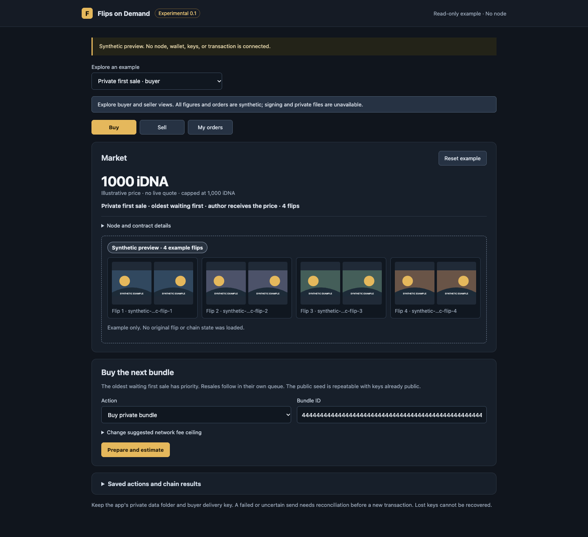
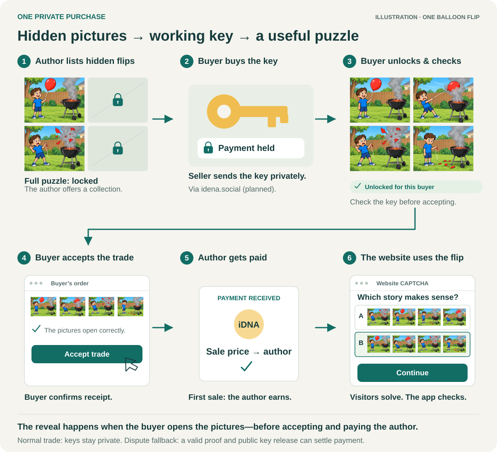

**Experimental software, without guarantees.** I am testing this out of curiosity while I consider Idena experimental and largely inactive; I currently have no profit intent. I may take this repository offline if the chain becomes mainstream. Published copies may remain available under the [MIT License](LICENSE). Do not use funds or keys you cannot afford to lose.

# Flips on Demand

**Pilot status:** Funded private delivery, resale, challenge fallback and public-seed purchases were tested with two identities run by one operator. Funded refund and expiry paths, independent operators and an external security audit remain open.

**A market for picture puzzles that websites could use as CAPTCHAs.**

Idena has produced **tens of thousands of human-reviewed picture puzzles**, called *flips*. People have already solved them and agreed on their answers. This project explores a second use: authors sell access to past puzzles, and CAPTCHA services buy them for websites.

Imagine a website offering a free trial. Its CAPTCHA provider buys and unlocks a collection of flips. Visitors solve a few before continuing. **The service pays. Visitors just solve—no wallet or crypto knowledge needed.**

## Optimistic bonded market v9 candidate

The new v9 implementation lets sellers list validated packages with a security deposit and complete normal sales without upfront content-proof registration. Disputes require both original-content and exact-delivery proofs. It includes standalone and IdenaAI clients, with v8 compatibility preserved. **The v9 pilot is deployed:** two five-flip purchases are settled and three buy orders remain queued. The native app can preview completed purchases; the standalone app provides its own local node connection. This is a common-operator pilot, not evidence of independent demand. [Design, usage, verification and limits →](docs/OPTIMISTIC_BONDED_MARKET_V9.md)

## Standalone v8 market

The new `fod app-v8` local browser client adds automatic package collection, reusable security deposits, curve quotes, both queues, private delivery verification and purchase export. It runs with your own synced node and does not require IdenaAI or a hosted market service. Connection pins are remembered after the first verified setup.

Run `./fod app-v8 -read-only-preview` after building the CLI to explore the interface without keys or funds. [Setup, package preparation and current limits →](docs/STANDALONE_V8.md)

The v8 interface is separate from the earlier v7 pilot documented below. Its funded end-to-end mainnet trade remains unverified; proof generation is still a separate local step.

## Try the earlier v7 local app

After [building `fod`](#build-the-cli), run `./fod app -read-only-preview` from `tools/fod` to explore synthetic buyer, seller and order screens. This mode needs no node, keys or funds and has no transaction endpoint. Real trading uses `./fod app` with your own synced node and independently verified contract pins; setup is [below](#run-the-standalone-local-app).



*Current standalone app in synthetic preview mode, captured locally on 21 October 2026. All balances, bundles and pictures shown are examples. [Mobile and order views →](docs/VISUAL_GUIDE.md#current-standalone-app)*

## The idea


*Concept illustration, not a trading-app screen. The same balloon flip is shown partly hidden for sale and fully unlocked as a CAPTCHA. [Picture source →](docs/VISUAL_GUIDE.md#real-flip-previews)*

## Why could this be useful?

- **Authors could earn again.** The whole first-sale price goes to the original author.
- **Services get existing puzzles and agreed answers**, saving challenge-creation work.
- **Visitors choose a story:** which arrangement of four pictures makes sense?

The proposed commodity is **access to puzzles with a history of human agreement.** Keys can be copied; access is not exclusive.

One historical session alone recorded **32,593 qualified flips** ([epoch 80](https://api.idena.io/api/epoch/80/flipStatesSummary)); that is not current market stock. Participants agree on answers through [Idena validation](https://docs.idena.io/docs/wp/technology#flip-consensus). The market verifies historical validation evidence against blockchain records. This human consensus does not guarantee resistance to AI.

## What happens when someone buys?

**The product is the unlocking key.** Only part of a flip is public. The key opens the complete pictures; the contract holds payment until settlement.



*Concept illustration. The current local app prepares and checks delivery files; the pictured website CAPTCHA integration is not implemented.*

The seller creates a buyer-specific **encrypted delivery file** and transfers it through a channel they choose. An encrypted idena.social message is optional; the app does not send one. The buyer verifies the delivered puzzle locally **before** accepting, then could serve it to visitors through a separate CAPTCHA service.

## What if the trade goes wrong—and what does it cost?

| What happens | Where the money goes |
| --- | --- |
| **Buyer checks the key and accepts** | First-sale price → author; on resale, half → author and half → shared reserve. Buyer and seller delivery bonds return. |
| **Seller proves and publishes working keys in time** | The same sale split applies; keys become public. A challenging buyer pays capped proof costs from their bond. |
| **Still unsettled at the deadline** | Refund claim → buyer gets price + bond back, plus the seller’s delivery bond as compensation. |

The price cap is **1,000 iDNA per collection**, plus bonds and network fees. In a private sale, both sides post bonds. Example: a buyer locks a 500 iDNA price + 500 bond; acceptance returns the bond. These amounts are illustrative. Extra seller collateral for unproved content can remain locked or be forfeited. A public seed purchase settles immediately without a buyer bond. [Worked costs, deadlines and dispute arrows →](docs/VISUAL_GUIDE.md#direct-v7-listing--trade--resolution)

## What exists today?

A source-built `fod` executable provides the standalone local browser app and typed CLI. The IdenaAI page is development source only; published desktop binaries do not include it. The pictured CAPTCHA service is a concept, not a complete integration. There is no guarantee of one person per account.

[See the current desktop, mobile and order screens →](docs/VISUAL_GUIDE.md#current-standalone-app) · [Technical setup below ↓](#technical-details)

## Technical details

<details>
<summary>Interfaces, contract versions, setup and command reference</summary>

This repository explores sales of access to the original decryption keys of historical Idena flips. It contains several contract prototypes. **Direct escrow v7** is the one-seed contract described below: one permanently public seed bundle anchors a queue of private first sales and resales. The current strict-value candidate has no administrator or platform fee; network transaction fees, bonds, and the contract's published sale and reserve rules still apply. Its funded tests used two identities controlled by one operator and included both cooperative private settlement and challenged public fallback. This does not establish independent delivery, an external audit, or general readiness.

The [v7 contract guide](contracts/direct-escrow-v7/README.md) explains settlement and risks. The [v7 manifest](release/DIRECT_V7_MANIFEST.json) identifies the public candidate WASM and its expected code hash; its deployment field is *not* a directory of trusted live contracts. Independently establish the address and deployed code of any contract you intend to call.

### Choose an interface

| Path | What it supports |
| --- | --- |
| **Standalone local app → own node** | Build one `fod` executable, run `fod app`, and use the browser page it opens on your computer. No IdenaAI installation or hosted market service is needed. It reads the v7 queue, prepares typed actions, shows a separate review before signing, saves attempts for reconciliation, and handles private ciphertext and receipts as local files. You still need your own synced Idena node and independently verified contract pins. |
| **IdenaAI → Flip market** | The [development source branch](https://github.com/ubiubi18/IdenaAI/tree/vibe/fod-social-bridge) adds **Flips on Demand v0.1**. It reads the next eligible bundle and quote from your synced loopback node, shows CID-matched public explorer previews, and prepares, reviews, and submits typed actions through a separately built `fod` CLI. The app checks the address and hashes you enter against the node and local file; you must establish the deployment and build provenance independently. Private delivery files remain local. Published desktop binaries do not include this source-only page or the CLI. |
| **Own node → `fod` CLI** | The typed v7 path for qualifying and proving bundles, publishing the seed, activating, listing, private buying, local encrypted delivery and receipt verification, cooperative confirmation, challenging, and public fallback. It checks the selected contract, code hash, and current state before preparing or signing. |
| **Own node → JSON-RPC** | Read v7 state and make contract calls manually if you do not use the CLI. You must check method arguments, attached value, fees, account, and changed chain state yourself. |

The bundled browser page in `app/` is an experimental viewer with synthetic sample state; importing a snapshot does not verify chain state or sign a transaction. Do not mix contract versions, addresses, or prepared actions.

### Before using v7

You need a fully synced Idena node you control, its **local** RPC endpoint and API key file, and the identity that will pay for the call. A seller also needs the original flip inventory, canonical session evidence, a sealed content proof with its verifier host, and an encrypted epoch-key vault. These are private working files, not repository fixtures. A private buyer needs a dedicated delivery key and a way to receive and verify the seller's ciphertext. The contract does not deliver that ciphertext.

Keep RPC and node keys in owner-only files. Use a loopback RPC URL, or a local tunnel to your own node; never expose its key over plain remote HTTP. The examples use `curl`, `jq`, Python 3, and Go (see [`.tool-versions`](.tool-versions)). Replace every placeholder with values checked against your own node. The CLI uses **integer iDNA base units** (`10^18` units per iDNA) for amounts and fees; node JSON-RPC uses **decimal iDNA** for `amount` and `maxFee`.

#### Build the CLI

The public CLI module depends on Idena node source. This local build recipe uses a public node-source revision and leaves tracked module files untouched:

```bash
git clone https://github.com/ubiubi18/flips-on-demand.git
git clone https://github.com/ubiubi18/idena-go.git
git -C idena-go checkout bffafb9cbf94f5f776af341748816e8da86a7e95
NODE_SOURCE="$(pwd)/idena-go"
cd flips-on-demand/tools/fod
cp go.mod go.local.mod
cp go.sum go.local.sum
go mod edit -modfile=go.local.mod "-replace=github.com/idena-network/idena-go=$NODE_SOURCE"
go mod tidy -modfile=go.local.mod
go test -modfile=go.local.mod -run 'TestDeriveEpochKeysMatchesPinnedNode|TestHistoricalNodeBlobOpensWithRecordedKeys' .
go build -modfile=go.local.mod -o fod .
```

Compare the candidate WASM's SHA-256 and deployed code hash with the manifest before trusting a deployment. A matching manifest alone does not prove that a contract is safe.

The test in the build recipe rejects a node-source revision whose epoch-key mapping differs from the CLI. The frozen blob fixture was built with an older mapping and checks opening with its recorded keys; it is not a derivation vector for the pinned node source. Before qualifying a new bundle, verify every intended original flip opens with the derived keys.

#### Run the standalone local app

With your own synced node running, start the built executable and supply its loopback RPC, owner-only API-key file, and a contract address and deployed code hash you verified independently:

```bash
RPC_URL='http://127.0.0.1:9019'
RPC_KEY_FILE='/absolute/path/to/your/rpc-key-file'
CONTRACT='your-independently-verified-40-hex-contract-address'
CODE_HASH='your-independently-verified-64-hex-deployed-code-hash'
NODEKEY_FILE='/absolute/path/to/your/nodekey-file'
./fod app -rpc "$RPC_URL" -key-file "$RPC_KEY_FILE" \
  -contract "$CONTRACT" -code-hash "$CODE_HASH" -nodekey "$NODEKEY_FILE"
```

The executable opens a page bound to `127.0.0.1` and prints its URL if your browser does not open. Enter the pairing code printed in the terminal before using the page; a reload requires pairing again. Omit `-nodekey` for read-only use. The app's private actions, delivery keys, and receipts stay in an owner-only local data folder; keep that folder and the nodekey secure. Signing attempts also reserve the identity nonce in a separate owner-only local journal until the chain outcome can be reconciled. The browser page cannot send a transaction during preparation: it requires a separate review and signing step. The seller must still transfer a generated ciphertext file to the buyer through a channel of their choice. The standalone page checks the original CID inventory against contract storage, then optionally displays images from the public Idena explorer; missing explorer images do not block trading, and pictures are not content or delivery proof. The node's current fee rate and a read-only call estimate suggest a fee ceiling, which remains visible for review and can be overridden. This is an experimental local interface, not a verified deployment directory or a substitute for an independent security audit.

For a read-only JSON view of the same v7 queue, use `./fod direct-v7-market -direct-version 7 -network idena -rpc "$RPC_URL" -key-file "$RPC_KEY_FILE" -contract "$CONTRACT" -code-hash "$CODE_HASH" -out -`. It includes the oldest selectable offer, the current quote, and open orders; it does not sign or send a transaction.

#### Read your node and contract

Idena RPC requests put the API key in the JSON body's top-level `key` field. This helper reads it from a file without placing it in the command line. See the [Idena node RPC reference](https://rpc.idena.io/) for the node API:

```bash
RPC_URL='http://127.0.0.1:9019'
RPC_KEY_FILE='/absolute/path/to/your/rpc-key-file'
CONTRACT='your-independently-verified-40-hex-contract-address'

rpc() {
  jq -n --rawfile api_key "$RPC_KEY_FILE" --arg method "$1" --argjson params "$2" \
    '{key:($api_key | rtrimstr("\n")), method:$method, params:$params, id:1}' |
    curl -fsS -H 'Content-Type: application/json' --data-binary @- "$RPC_URL" | jq .
}

rpc bcn_syncing '[]'
rpc dna_epoch '[]'
rpc dna_getCoinbaseAddr '[]'
rpc bcn_feePerGas '[]'
CALLER="$(rpc dna_getCoinbaseAddr '[]' | jq -er '.result')"
rpc dna_getBalance "$(jq -nc --arg a "$CALLER" '[$a]')"
rpc contract_getStake "$(jq -nc --arg c "0x$CONTRACT" '[$c]')"
rpc contract_readData "$(jq -nc --arg c "0x$CONTRACT" '[$c,"pool/seed-id","hex"]')"
rpc contract_readData "$(jq -nc --arg c "0x$CONTRACT" '[$c,"pool/value-policy","hex"]')"
rpc contract_readData "$(jq -nc --arg c "0x$CONTRACT" '[$c,"pool/primary-head","hex"]')"
rpc contract_readData "$(jq -nc --arg c "0x$CONTRACT" '[$c,"pool/secondary-head","hex"]')"
rpc contract_iterateMap "$(jq -nc --arg c "0x$CONTRACT" '[$c,"pool/offer/",null,"hex","hex",200]')"
```

Compare `contract_getStake.result.Hash` with the manifest's `artifact.codeHash` **only if this is the intended candidate deployment**. A missing hash, unexpected seed, wrong active identity, syncing node, or stale queue is a stop condition. The primary head has priority; the secondary head is selectable only when the primary queue is empty. Continue `contract_iterateMap` with its returned continuation token until exhausted; its offer values are raw 222-byte records. `contract_readData` also exposes `pool/reserve`, `pool/insurance`, `pool/primary-units`, `pool/secondary-units`, `pool/order/<decimal order ID>`, and, after public fallback, `pool/reveal/<decimal order ID>`. These are raw contract values, not a verified market summary.

#### If you deploy your own instance

An existing v7 address is unnecessary if you deploy the candidate yourself. The constructor pins **one** seed bundle ID; you must be able to qualify, prove, and publicly disclose that real bundle before activation. From `tools/fod`, `prepare-deploy` signs a transaction carrying **one refundable base unit** into a private file but never broadcasts it. Build the reviewed source revision in a separate clean checkout and take its `artifact.codeHash` as the independent `-code-hash` pin; do not take the pin from the manifest beside the WASM you are about to sign. Supply this pin, a live base-unit fee rate, sufficient maximum fee for the large WASM deployment, your next nonce, and current epoch:

```bash
SEED_ID='your-verified-64-hex-seed-offer-id'
REVIEWED_MANIFEST='/absolute/path/to/separate/clean-build/DIRECT_V7_MANIFEST.json'
CODE_HASH="$(jq -er '.artifact.codeHash' "$REVIEWED_MANIFEST")"
FEE_PER_GAS_BASE='your-current-base-unit-rate'
MAX_FEE_BASE='your-reviewed-base-unit-fee-ceiling'
NEXT_NONCE='your-next-account-nonce'
TX_EPOCH='your-current-chain-epoch'
NODEKEY_FILE='/absolute/path/to/your/nodekey-file'
DEPLOY_SIGNED='/absolute/path/to/private/deploy-signed.json'
./fod prepare-deploy -code ../../release/artifacts/fod_direct_escrow_v7.wasm \
  -code-hash "$CODE_HASH" -v7-seed-id "$SEED_ID" -network idena -nodekey "$NODEKEY_FILE" \
  -nonce "$NEXT_NONCE" -tx-epoch "$TX_EPOCH" \
  -fee-per-gas "$FEE_PER_GAS_BASE" -max-fee "$MAX_FEE_BASE" \
  -signed "$DEPLOY_SIGNED"
```

Review the recorded sender, derived address, seed ID, code hash, one-unit amount, fee, and signed bytes. After a fresh nonce, balance, sync, and fee check, send `rawTx` with your own node's RPC:

```bash
RAW_TX="$(jq -er '.rawTx' "$DEPLOY_SIGNED")"
rpc bcn_sendRawTx "$(jq -nc --arg tx "0x$RAW_TX" '[$tx]')"
```

Verify the transaction receipt and the derived address's deployed hash and pinned seed. Set `CONTRACT` to that verified derived address before later calls. Do not send another deployment if the first response is uncertain. The [contract guide](contracts/direct-escrow-v7/README.md) describes the required seed proof, publication, and irreversible 10,000 iDNA activation deposit.

### Use the typed v7 CLI

From `tools/fod`, set local paths and independently checked values. `CODE_HASH` is the deployed code hash **without** `0x`, `MAX_FEE_BASE` is a positive base-unit ceiling informed by a fresh fee and gas estimate, and `OFFER_ID` is a 32-byte lowercase hex author-and-epoch bundle ID:

```bash
CODE_HASH='your-verified-64-hex-code-hash'
MAX_FEE_BASE='your-reviewed-base-unit-fee-ceiling'
OFFER_ID='your-verified-64-hex-offer-id'
SESSION_FILE='/absolute/path/to/your/canonical-session.json'
NODEKEY_FILE='/absolute/path/to/your/nodekey-file'
PREPARED='/absolute/path/to/private/prepared.json'
SIGNED='/absolute/path/to/private/signed.json'

./fod direct-v7-prepare -direct-version 7 -network idena \
  -rpc "$RPC_URL" -key-file "$RPC_KEY_FILE" \
  -contract "$CONTRACT" -code-hash "$CODE_HASH" -max-fee "$MAX_FEE_BASE" \
  -operation buy -v7-offer-id "$OFFER_ID" -session "$SESSION_FILE" \
  -delivery-key '/absolute/path/to/private/new-delivery-key' -prepared "$PREPARED"
```

`direct-v7-prepare` reads the live node, checks the oldest offer and canonical session, retains every original encrypted flip from the buyer's node, creates a separate delivery key, estimates the call, and writes a private unsigned action. It does **not** buy anything. Inspect the prepared file and recheck the quote plus required buyer bond, active identity, code hash, queue head, balance, and fee budget. Private `buy` locks **quote plus buyer bond**; it cannot buy a public seed.

To send, provide your nodekey, the next nonce (`dna_getBalance.nonce + 1` when its `mempoolNonce` equals `nonce`) and current `dna_epoch.epoch`, and the same pins. `submit` rechecks the live state before signing and sending. Recheck the node and all terms immediately before this call; omit `-broadcast` if you only want to write a signed transaction:

```bash
NEXT_NONCE='your-next-account-nonce'
TX_EPOCH='your-current-chain-epoch'
./fod submit -prepared "$PREPARED" -nodekey "$NODEKEY_FILE" \
  -nonce "$NEXT_NONCE" -tx-epoch "$TX_EPOCH" -max-fee "$MAX_FEE_BASE" \
  -contract "$CONTRACT" -code-hash "$CODE_HASH" \
  -rpc "$RPC_URL" -key-file "$RPC_KEY_FILE" -signed "$SIGNED" -broadcast
```

The typed CLI also accepts these `-operation` values for `direct-v7-prepare`. For an operation marked **Call value**, the revised contract requires exactly **one base unit** (0.000000000000000001 iDNA) and returns it to the caller on success. The older pilot contract has no `pool/value-policy` key and requires zero. Check the exact deployed code and policy; the CLI reads the policy again before signing. Network gas fees still apply.

| Operation | Who and required extra input | Attached value |
| --- | --- | --- |
| `qualify` | Bundle author: `-session`, `-proof`, `-registration-host` | Call value |
| `proveBundle` | Anyone: same proof inputs; proves original content before sale, or with a v7-bound proof before a funded order's deadline | Call value |
| `seedBundle` | Seed author: `-vault`; **publishes the seed's keys** | Call value |
| `activate` | Any funder: `-v7-offer-id`, after the one seed is proved and published | Exactly 10,000 iDNA, permanently locked without a redeemable share |
| `list` | Qualified author: `-session`, `-vault`; optional `-minimum-payout` in base units | Current seller delivery bond, plus 1,000 iDNA fraud collateral if content is unproved |
| `buy` | Private buyer: `-v7-offer-id`, canonical `-session`, `-delivery-key` output path | Current quote plus required buyer bond |
| `buyPublicSeed` | Buyer: expected oldest public `-v7-offer-id`; settles immediately with no private order | Exact current quote |
| `confirm` | Funded buyer: `-order`, `-delivery` signed receipt from `direct-v7-receive` | Call value |
| `challenge` | Funded buyer: `-order` | Call value |
| `startFallback` | Seller: `-order`. A pre-proven offer uses the short path. An unproved offer also needs `-session`, `-proof`, and `-registration-host` for a sealed proof bound to this v7 contract | Call value |
| `proveAndReveal` | Seller: `-order`, `-vault`; **publishes the private bundle's keys** | Call value |
| `refund` | Anyone: `-order`, only after the proof deadline on a still funded order; retires the offer | Call value |
| `relist` | Author: sold or cancelled private `-v7-offer-id`; optional `-minimum-payout` | Current seller bond, plus fraud collateral if still unproved |
| `cancel` | Author: queued private `-v7-offer-id`; an unproved listing forfeits fraud collateral | Call value |
| `expireHead` | Anyone: expected oldest `-v7-offer-id`, after 30,240 selectable blocks; a public seed rotates | Call value |
| `topUpBond` | Author: queued private `-v7-offer-id` and explicit positive `-amount` in base units | The specified top-up |
| `slashUnproved` | Anyone: settled unproved `-order` after its content-proof deadline; retires the offer | Call value |

Prepare and submit each step separately after the preceding transaction is included and its state is checked. Do not seed or activate a new deployment with sample data. For an unproved `startFallback`, the CLI checks the pinned proof host, v7 contract binding, original CID inventory, key commitment, and canonical session roots before preparing the call; submission checks the live order and proof statement again. The contract verifies the seal and session at execution. `proveBundle` verifies original content; it does not prove that a buyer received a private message. A legacy v6-bound proof is allowed only for an unfunded qualified epoch-230 offer; proving after funding requires a proof bound to the live v7 contract. The fallback deadline is 12,960 blocks from funding; a failed or absent fallback may allow `refund` once that window ends. See the [contract guide](contracts/direct-escrow-v7/README.md) for payouts, bonds, queue order, and deadlines.

#### Verify private delivery before confirming

After the private `buy` is included, the seller can produce one encrypted JSON message from the funded order and their committed key vault. This command writes a local file; it does not send a message:

```bash
ORDER_ID='your-funded-private-order-id'
SELLER_VAULT='/absolute/path/to/private/seller-vault.age'
CIPHERTEXT_FILE='/absolute/path/to/private/new-ciphertext.json'
./fod direct-v7-dm -direct-version 7 -network idena \
  -rpc "$RPC_URL" -key-file "$RPC_KEY_FILE" \
  -contract "$CONTRACT" -code-hash "$CODE_HASH" -order "$ORDER_ID" \
  -vault "$SELLER_VAULT" -out "$CIPHERTEXT_FILE"
```

Transfer that file privately to the buyer using a channel you trust. The buyer uses their own synced node, the retained `buy` file, and its dedicated delivery key to verify the funded order, canonical session, original CIDs, key commitment, and decrypted flip parts. A successful check saves the keys in a new encrypted vault and signs a receipt with the delivery key:

```bash
DELIVERY_KEY_FILE='/absolute/path/to/private/delivery-key'
BUYER_VAULT='/absolute/path/to/private/new-buyer-vault.age'
RECEIPT_FILE='/absolute/path/to/private/new-receipt.json'
CONFIRM_PREPARED='/absolute/path/to/private/new-confirm-prepared.json'
./fod direct-v7-receive -direct-version 7 -network idena \
  -rpc "$RPC_URL" -key-file "$RPC_KEY_FILE" \
  -contract "$CONTRACT" -code-hash "$CODE_HASH" -order "$ORDER_ID" \
  -message "$CIPHERTEXT_FILE" -purchase "$PREPARED" \
  -delivery-key "$DELIVERY_KEY_FILE" -vault "$BUYER_VAULT" -out "$RECEIPT_FILE"

./fod direct-v7-prepare -direct-version 7 -network idena \
  -rpc "$RPC_URL" -key-file "$RPC_KEY_FILE" \
  -contract "$CONTRACT" -code-hash "$CODE_HASH" -max-fee "$MAX_FEE_BASE" \
  -operation confirm -order "$ORDER_ID" -delivery "$RECEIPT_FILE" \
  -prepared "$CONFIRM_PREPARED"
```

Inspect and submit `CONFIRM_PREPARED` with the buyer's nodekey using the `submit` pattern above. Confirmation settles the order and commits the SHA-256 of the exact verified ciphertext on-chain. The CLI checks the receipt signature and live funded order again before signing. Delivery and receipt outputs are create-only; choose new paths for a later attempt. Keep the message, purchase file, delivery key, receipt, and vault private. A ciphertext file or a seller's claim alone is not evidence of a usable delivery.

### Make a manual node RPC call

You can call the same methods without the CLI through your own node's `contract_estimateCall` and then `contract_call`, supplying the exact wire argument and attached value. **The node signs `contract_call` with its active identity.** Read the corresponding export in [`contracts/direct-escrow-v7/src/lib.rs`](contracts/direct-escrow-v7/src/lib.rs) before sending; a successful estimate is not an inclusion guarantee.

For example, `buyPublicSeed` takes the expected oldest public seed ID as one 32-byte `hex` argument and requires the **exact** current quote, with no buyer bond. Read the four pricing fields in `bigint` format, then calculate the quote using integer arithmetic; never round it through floating point. The pricing reserve is `reserve - insurance`, and the denominator is `primary-units + secondary-units + 9`. Cap the rounded-up result at 1,000 iDNA. This purchase settles immediately and creates **no disputable order**:

```bash
read_bigint() {
  rpc contract_readData "$(jq -nc --arg c "0x$CONTRACT" --arg k "$1" '[$c,$k,"bigint"]')" | jq -er '.result'
}

PRIMARY_UNITS="$(read_bigint pool/primary-units)"
SECONDARY_UNITS="$(read_bigint pool/secondary-units)"
RESERVE_BASE="$(read_bigint pool/reserve)"
INSURANCE_BASE="$(read_bigint pool/insurance)"
QUOTE_IDNA="$(python3 - "$PRIMARY_UNITS" "$SECONDARY_UNITS" "$RESERVE_BASE" "$INSURANCE_BASE" <<'PY'
import sys
primary, secondary, reserve, insurance = map(int, sys.argv[1:])
units, pricing_reserve = primary + secondary, reserve - insurance
if units < 1 or pricing_reserve < 1:
    raise SystemExit('no valid quote')
base = 10**18
quote = min(1000 * base, (pricing_reserve + units + 8) // (units + 9))
print(f'{quote // base}.{quote % base:018d}'.rstrip('0').rstrip('.'))
PY
)"

# Re-read both queue heads. Use the currently selectable public seed, without 0x.
OFFER_ID='your-verified-64-hex-public-seed-id'
CALLER="$(rpc dna_getCoinbaseAddr '[]' | jq -er '.result' | sed 's/^0x//')"
MAX_FEE_IDNA='your-reviewed-decimal-idna-fee-ceiling'
CALL="$(jq -nc --arg from "0x$CALLER" --arg contract "0x$CONTRACT" \
  --arg amount "$QUOTE_IDNA" --arg maxFee "$MAX_FEE_IDNA" --arg value "0x$OFFER_ID" \
  '{from:$from,contract:$contract,method:"buyPublicSeed",amount:$amount,maxFee:$maxFee,
    args:[{index:0,format:"hex",value:$value}]}')"
rpc contract_estimateCall "[$CALL]"
# After checking the live code, identity, head, exact quote, balance, fee, and estimate:
# rpc contract_call "[$CALL]"
```

For other calls, follow the same JSON-RPC shape but **do not reuse the public-seed amount or argument**. Each v7 export takes one `hex` argument at index 0. Integer fields are unsigned and big-endian; the lengths below are bytes.

| Argument layout | Methods |
| --- | --- |
| Offer ID (32) | `activate`, `buyPublicSeed`, `cancel`, `expireHead`, `topUpBond` |
| Order ID (8) | `challenge`, `refund`, `slashUnproved`, and `startFallback` for a pre-proven offer |
| Offer ID (32) + uncompressed delivery public key (65) | `buy` |
| Order ID (8) + SHA-256 of the exact verified ciphertext (32) | `confirm` |
| Offer ID (32) + minimum payout (16) | `relist` |
| Offer ID (32) + canonical epoch secrets (106) | `seedBundle` |
| Order ID (8) + canonical epoch secrets (106) | `proveAndReveal` |

`qualify`, `proveBundle`, `list`, and an unproved `startFallback` carry additional session, proof, or commitment fields. Use the typed CLI to construct and validate those calls, or follow their exact encoders in [`tools/fod/direct_v7_pool_calls.go`](tools/fod/direct_v7_pool_calls.go) and the contract exports. Check the attached value in the operation table above. The revised contract rejects a missing or excessive call value on state-only methods. A direct transfer to the contract address is separate from a method call and does not create a withdrawal claim. Simulate the exact call before sending it.

After any broadcast, retain the returned transaction hash and query its receipt and contract state from your own node:

```bash
TX_HASH='your-returned-transaction-hash'
rpc bcn_txReceipt "$(jq -nc --arg h "$TX_HASH" '[$h]')"
```

If the response is missing or uncertain, reconcile the hash, nonce, mempool, receipt, and changed state before trying again; a timeout does not mean the transaction failed. Public fallback or seed publication exposes keys permanently. The contract cannot guarantee content availability, private-message delivery, or recovery of lost local files.

</details>

## License

[MIT](LICENSE). Third-party source and license notes are in [`THIRD_PARTY.md`](THIRD_PARTY.md).
