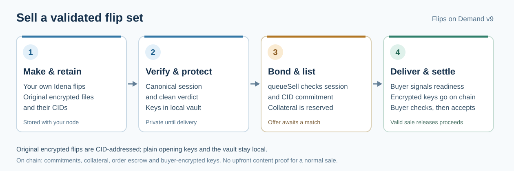

# Sell a validated flip set (v9)

Flips on Demand sells access to the **original encrypted flips** from one Idena author and epoch. The seller must be that author. A v9 set can contain 1–32 flips, and the canonical validation result must report the same count with a clean verdict. Uploading unrelated pictures or copying someone else's CIDs does not make a sellable set.

[PNG version for sharing](visuals/v9-seller-flow.png).

## Before listing

You need a compatible, synced Idena node for the author identity, authenticated loopback RPC, its owner-only local signing key, the original encrypted flip files, and a canonical capture of that epoch's validation session. Follow the [standalone connection guide](STANDALONE_V8.md#connect-once) with **`app-v9`**, a separate v9 profile, and independently checked v9 contract and code pins. IdenaAI's v9 market page is another client for the same contract. The read-only preview uses synthetic data and cannot trade.

Capture the session while the node still has the relevant state. The standalone app can read an existing archive with `-archive-dir`; `-node-dir` can start its own separate capture archive when configured **before** validation and kept running through the session. An existing canonical session bundle can also be imported. Advanced users can build that file with `fod session-bundle` from retained historical node state or saved inventory and verdict anchors. If the original flips or verifiable session evidence are unavailable, wait for a future validation session rather than assembling a substitute package.

## Build your package locally

1. Create and submit flips through your own Idena node in the normal way. Keep that node and its original encrypted data available. In the v9 client, open **My flips → Collect & check**. It groups your flips by author and epoch, fetches each original encrypted file and verifies its CID (content fingerprint). Do not replace or re-encode these files.
2. Choose **Protect package** for the set. The client uses your local identity to derive the epoch keys, opens and checks every original flip, then saves the keys in a password-encrypted local vault. Keep the vault and its password; the password protects saved flip keys and is separate from your wallet password. The identity key is handled locally and must never be posted or sent to a buyer.
3. After validation has finished, use **Add saved validation evidence → Session bundle → Verify & add**, or let the connected archive supply the bundle. The client checks the author, epoch, exact CID inventory, validation verdict and canonical chain headers. The set becomes **Ready to sell** only when those checks, the original files and the local vault agree.

These local files and the session record are what this guide calls a *flip package*. The package is not a newly generated image ZIP or a public list of keys.

## List and complete a sale

1. Check the live curve quote, network fees and available seller security deposit. Fund or refill the reusable deposit with **Review deposit** if needed. The deposit is separate from the sale price and can be reserved or penalized while obligations are open.
2. Enable a bounded local trading session, select the ready set under **Market → Sell your package**, and click **Join sell queue**. Check the proposed terms and the confirmed transaction. V9's `queueSell` call checks the canonical session and package commitments, reserves seller collateral and lists the offer together. **There is no `registerBundle` call or upfront content proof for a normal v9 sale.** A listing alone does not guarantee a buyer or payment.
3. Wait for a compatible funded buy order and an included match. The market uses its current price curve and queue rules; `matchNext` advances compatible orders. An unfilled offer remains queued until matched, cancelled or expired. Keep the local app and node available for automatic queue processing under the approved session limits; closing them does not cancel an on-chain order or stop its deadlines.
4. The buyer first retains and CID-checks the encrypted files and signals readiness. Your client then encrypts the **opening keys**, not the identity key, to that buyer's delivery key and submits the ciphertext through the contract before the delivery deadline. Retain the original private delivery witness. The encrypted ciphertext is public on chain, but only the assigned buyer's delivery key should open it. **Do not send keys by idena.social DM.**
5. The buyer opens and checks every original flip before accepting. Acceptance settles the sale and releases the seller proceeds. If delivery is challenged or not accepted by the deadline, the separate [v9 dispute and proof rules](OPTIMISTIC_BONDED_MARKET_V9.md#dispute-or-missing-acceptance) apply; collateral alone is not proof of valid content.

For the contract's exact checks, prices and operation names, see the [v9 protocol guide](OPTIMISTIC_BONDED_MARKET_V9.md). Keep vaults, passphrases, delivery keys and private witnesses out of posts and screenshots.
