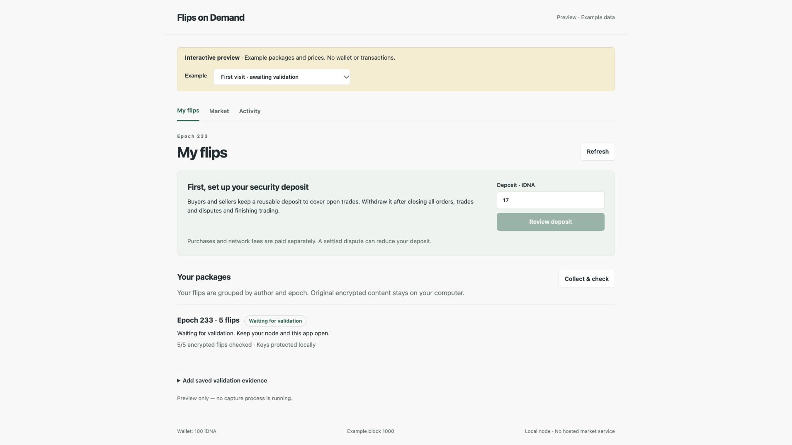
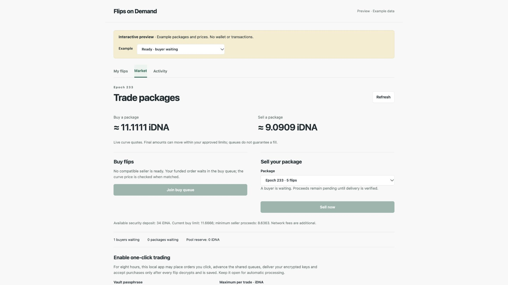

# Standalone local market (v8 and v9)

The `fod app-v8` executable serves a browser interface on your own computer. It uses a compatible, synced Idena node over authenticated loopback RPC. IdenaAI, a hosted market backend, a public explorer and a central delivery service are not required.

For the current optimistic market use `fod app-v9` in the commands below, with independently verified v9 contract pins and a separate profile. V9 needs no upfront proof registration for normal sales; the registration step below applies only to v8. Both versions share the local browser interface.

For the v9 seller path, follow [Sell a validated flip set](SELLER_GUIDE_V9.md) instead of the v8 proof-registration step in this page.

## Explore the interface

Build the CLI using the [repository build instructions](../README.md#build-the-cli), then run from `tools/fod`:

```bash
./fod app-v8 -read-only-preview
```

The example selector covers first use, no buyers, a waiting buyer, a funded pool, deposit refill and a completed purchase. Example prices, packages and purchased flip images are synthetic. This preview has no transaction endpoints. `-no-browser` prints the URL without launching a browser.



## Connect once

Set the values below to your own local node and independently verified v8 deployment. Do not reuse v7 contract pins. Use a separate profile and app data folder for each identity; keep them owner-only.

```bash
RPC_URL='http://127.0.0.1:9019'
RPC_KEY_FILE='/absolute/path/to/your/api.key'
CONTRACT='your-verified-40-hex-v8-contract'
CODE_HASH='your-verified-64-hex-v8-code-hash'
NODEKEY_FILE='/absolute/path/to/your/nodekey'
PROFILE='/absolute/path/to/your/private-market/connection.json'
./fod app-v8 -profile "$PROFILE" \
  -rpc "$RPC_URL" -key-file "$RPC_KEY_FILE" \
  -contract "$CONTRACT" -code-hash "$CODE_HASH" \
  -nodekey "$NODEKEY_FILE"
```

Enter the pairing code printed by the executable. The API and identity keys stay in the local process; the page receives neither. The connection is saved only after a successful pinned market read. Subsequent launches need only:

```bash
./fod app-v8 -profile "$PROFILE"
```

Use `-read-only` to remove signing access from this profile, including a previously saved key path. Re-enable it explicitly with `-nodekey` when needed. A browser reload requires pairing again.

### Validation evidence

- `-archive-dir /absolute/path/to/existing/archive` reads an existing session capture and verifies its canonical headers. It does not restart that watcher or change its witnesses or archive.
- `-node-dir /absolute/path/to/native/node/data` optionally starts the bundled Python 3 capture tool in **this app's separate archive**. The folder must belong to the same node used by the RPC connection, contain its API key, and be readable by this process. Keep the app and node running across validation. This option is unnecessary when an existing watcher already captures the session.
- `-app-data-dir /absolute/path/to/private/library` chooses a separate local library. By default it is the profile's parent folder.

## User journey

1. **My flips:** current node flips are discovered automatically, grouped by author and epoch, fetched through the node and verified against their original CIDs. Every changed inventory is preserved separately. Missing or corrupt data is reported.
2. **Protect package:** the owner explicitly unlocks the local identity key to check the content and save an encrypted epoch-key vault plus an owner-only content witness. Existing witnesses are preserved. Keep the passphrase; it is needed for delivery.
3. **Verify validation:** import a canonical session bundle, or let the connected archive provide it. The author, original inventory, verdict and header roots must verify before the UI treats validation as complete.
4. **Register proof:** generate a v8 contract-bound proof with the existing local content prover, then import it with the session in Activity. Proof generation is a separate operation in this version. The CLI checks the statement and simulates the exact registration before showing a signing review.
5. **Security deposit:** buyers and sellers deposit collateral once and reuse it. Purchases and network fees are separate. The suggested amount covers the current quote and existing reservations. After a penalty, new trades remain blocked until the required target is restored.
6. **Trade:** the Market shows current curve quotes, recent completed trade prices, open offers and demand, pool reserve, trade escrow and security deposits separately. Enable a bounded, eight-hour local trading session, then buy or sell with one click within its limits. The suggested per-trade maximum is the current buy quote plus 5%, not the deposit amount. Compatible demand uses the shared queues; an unmatched order waits. Pool acquisition requires actual reserve. A pool purchase holds the seller's proceeds until eventual delivery is settled. The price graph and purchased-set list cover only the recent terminal trades included in the market snapshot.
7. **Delivery:** the buyer retains and CID-checks the encrypted flips before readiness. The seller sends keys encrypted for that buyer. The buyer decrypts and verifies every original flip and saves an encrypted local vault before acceptance. The app advances these steps only while the local permission is active.
8. **Use purchased packages:** recent completed buyer purchases appear under My flips. View both original four-image sequences for each flip directly in the browser using the locally verified delivery key; this read-only preview does not request a password. The images are removed from the page when the viewer closes or the identity changes. A completed purchase can also be exported as a ZIP with the manifest, original encrypted flips and encrypted key vault. The password is not included. “Password for saved flip sets” means the local password protecting saved keys; it is separate from the wallet password.
9. **Finish trading:** cancel unassigned orders and settle all trades/disputes. Then review withdrawal of the entire remaining deposit. Open obligations prevent withdrawal.
10. **Community:** the optional idena.social tab loads the fixed site only when opened, inside a sandboxed frame. It does not receive the local pairing token or a market bridge. An external link is provided if the site cannot be framed.



## Authority and recovery

- The one-click session is tied to the current identity, this process and its pinned contract. It has a per-trade exposure limit, a total purchase budget and a separate total fee budget. It expires after eight hours or app exit. It does not deposit, withdraw, fund the reserve, register proofs or initiate disputes automatically.
- Orders retain the maximum/minimum shown when clicked. Automatic queue advancement is permissionless and operates on shared queues; another participant's concurrent transaction can change which order is first. The fee budget still applies.
- Existing obligations can be processed after a collateral penalty; opening another buy/sell remains blocked. Pausing the session does not cancel chain orders or stop their deadlines.
- Every transaction is simulated, journaled and bound to the reviewed terms. Ambiguous attempts stop automatic processing and require reconciliation. Budget is consumed conservatively before a submission attempt; a timeout never authorizes retrying it.
- Seller dispute proof generation remains a separate local-prover operation. Activity supports importing the completed proof. The app does not promise profit, proof completion, liquidity or a queue fill.
- Saved signing keys, passphrases, witnesses and delivery secrets are never browser assets. All market requests go to the user's loopback node. Encrypted delivery is stored on chain by the v8 protocol.
- No stars or star premium are used. Packages have the existing contract's equal curve weight.

## Verification for this addition

Focused checks on 24 October 2026:

- 21 Go tests across the standalone app and v8 helpers passed, including real v8 unsigned preparation against an RPC fixture, CID integrity, identity separation, forged-session rejection, read-only/preview boundaries, pending-attempt refusal, nonce protection, fee limits and expired session permissions.
- Five browser-model tests passed for exact amounts, deposit coverage, refill blocking, curve constraints and queue labels.
- Executable built successfully; first-use and market views were inspected in the browser.

These checks do not constitute a new funded mainnet trade, a new proof-generation run, an external audit or a live-node capture test of this new wrapper. The currently shown browser is the explicitly labelled preview. Existing production watchers and pending deposit reviews were not modified.
