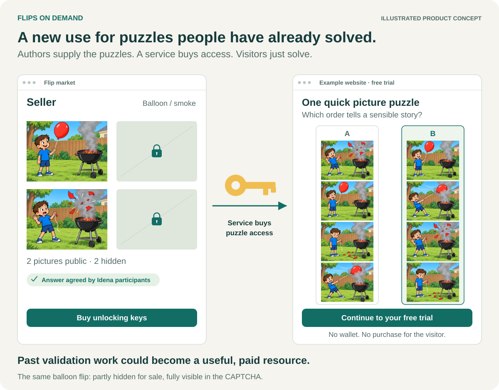
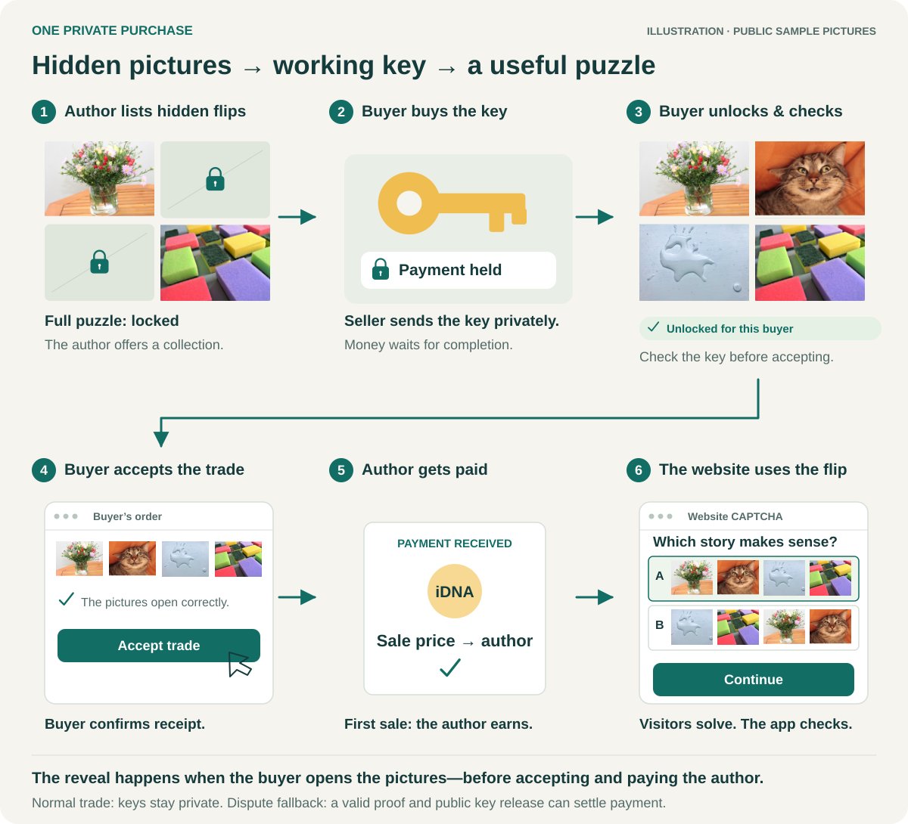
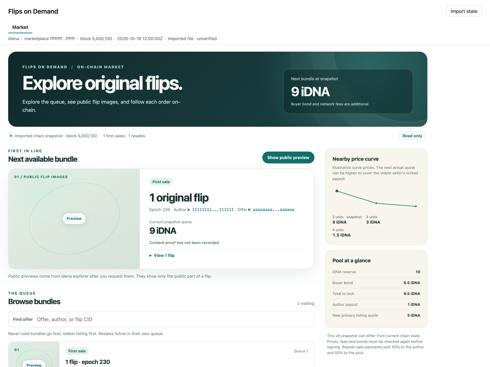
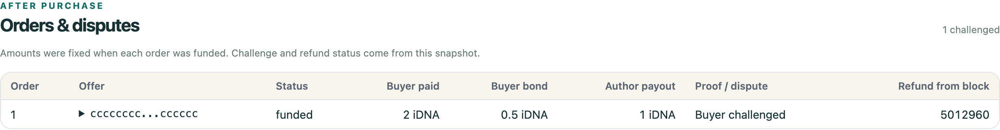
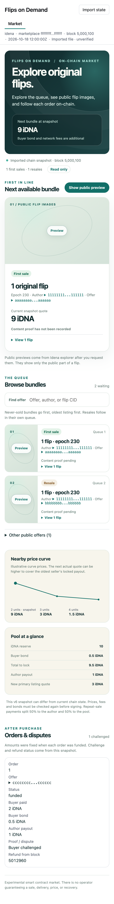
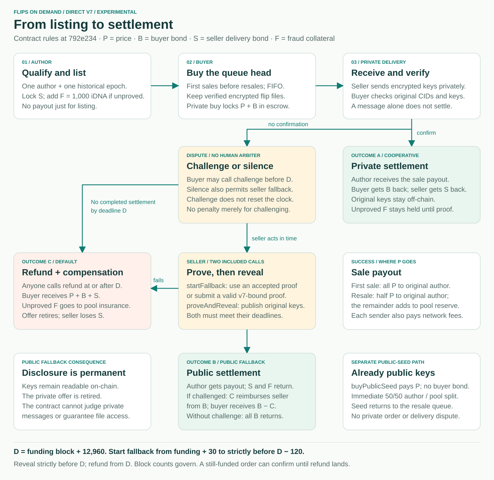
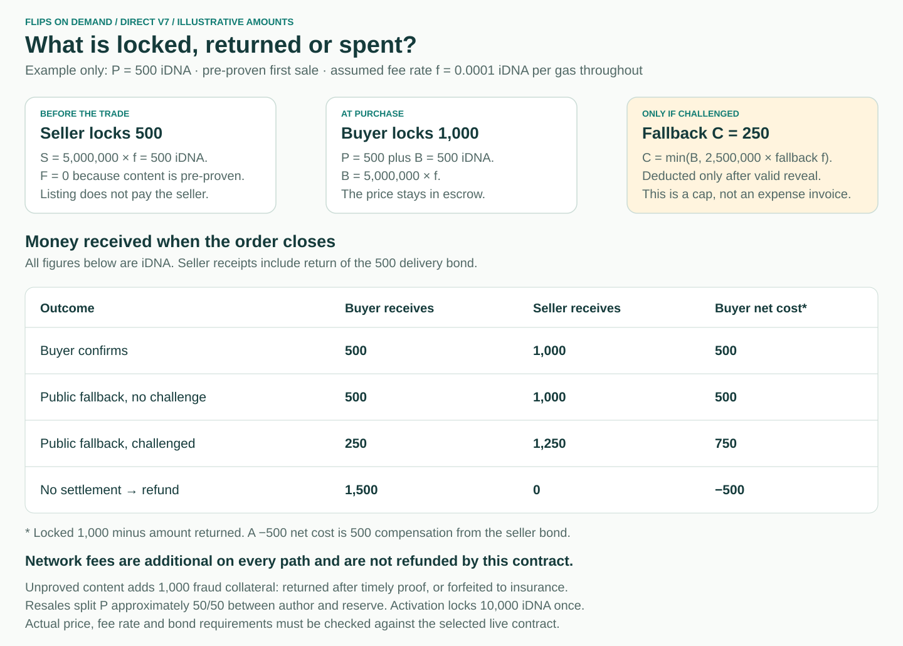

# Flips on Demand — visual guide

UI captures and diagrams based on repository revision [`792e234`](https://github.com/ubiubi18/flips-on-demand/tree/792e234), checked on **18 October 2026**. These illustrate an experimental implementation; they do not establish a safe funded release.

## The idea in pictures

The README opens with **illustrated product concepts**, followed by a six-step private purchase. These are explanatory drawings, not screenshots of implemented checkout or CAPTCHA functionality. They show the value to a website visitor before introducing contract mechanics.

The story deliberately shows the buyer unlocking and checking the pictures **before** accepting the trade. That private reveal differs from public fallback, where working keys are disclosed to everyone. The illustrated service hosts the CAPTCHA and decides access; the market settles the content purchase.

**Intended delivery channel: an encrypted idena.social direct message.** The seller would send the buyer-encrypted key package there; the buyer verifies the received package and confirms the trade. Current v7 market tools prepare and verify delivery files but do not automatically send them through idena.social. The diagram labels this integration as planned. The contract checks settlement evidence, not whether a social message was received.

### Resource size and human agreement

The README's “tens of thousands” claim describes historical production, not available marketplace stock. On 18 October 2026 the official explorer API returned **37,633 total flips** for [epoch 80](https://api.idena.io/api/epoch/80/flips/count), with **32,593 `Qualified`**, 3,178 `QualifiedByNone`, 868 `NotQualified` and 881 `WeaklyQualified` in its [status summary](https://api.idena.io/api/epoch/80/flipStatesSummary). The `Qualified` count alone supports the claim; the other categories are not added to it. That session took place on 22 January 2022. These counts do not establish that original files and keys remain available or eligible for sale.

Idena's [flip consensus documentation](https://docs.idena.io/docs/wp/technology#flip-consensus) explains how validation participants agree on the answer. Its [encryption description](https://docs.idena.io/docs/wp/technology#flips-encryption) explains why only two of four pictures are normally public. Human-reviewed does not mean that every source image was made by a human, or that a reused puzzle is resistant to current AI.

The v7 [`qualify` implementation](../contracts/direct-escrow-v7/src/lib.rs) checks the historical flip inventory and clean validation status against canonical chain roots, through [`fast-session-core`](../proofs/fast-session-core/src/lib.rs). The private content/key proof is a separate check. Blockchain verification anchors the historical evidence; it does not conduct a new human vote on the purchased puzzle or certify CAPTCHA security.

## Real flip previews

The opening market concept shows a single **Seller** and one balloon / smoke flip. Both the website CAPTCHA and the six-step trade story use all four original pictures from that same flip. The other two pictures on the seller side are covered with drawn locks to illustrate a private sale.

Source: [epoch-230 balloon / smoke flip](https://scan.idena.io/flip/bafybeihodzhdrfo47w64d5gad3t5em3tzw5556ya43omq24eajtqigyhtq), originally submitted by IdenaAI 3, author `0x1af4820204ddcd1a882359198227798f463f3058`. The visible role is “Seller”; the original author is credited here for provenance.

The four `visuals/balloon-{1,2,3,4}.png` files preserve the original picture bytes. They were extracted from the owner's local copy of this exact flip on 18 October 2026, following the owner's explicit request to publish the complete balloon example. The first two match the [public explorer picture response](https://api.idena.io/api/flip/bafybeihodzhdrfo47w64d5gad3t5em3tzw5556ya43omq24eajtqigyhtq/content) byte for byte. The other two came from the flip's encrypted private part; they are not claimed to have been returned by the public preview API. Only these requested pictures were exported; no keys, private witness files or other flip content are included.

The CAPTCHA preserves the flip's original arrangements, numbered by these filenames: **A = 1, 2, 4, 3** and **B = 2, 3, 1, 4**. B tells the story: the child holds the balloon, it moves over the barbecue, it bursts, and the child sees the remains. B is selected in the illustration, matching the explorer's recorded answer. The left preview and unlocked trade views follow B, covering pictures 3 and 4 while showing the originally public pictures 2 and 1.

This complete example is now intentionally disclosed for documentation. The locks illustrate the market mechanism; they do not make the published example secret or establish that it is an eligible private offer. Attribution is also recorded in [THIRD_PARTY.md](../THIRD_PARTY.md#documentation-illustrations).

## Current UI

The screenshots show the actual bundled browser app, rebuilt from source, with the synthetic `snapshot()` fixture in [`app/test/direct-pool.test.ts`](../app/test/direct-pool.test.ts). Addresses, prices, balances, CIDs and order states are examples. The browser clock and fixture timestamp were fixed at `2026-10-18T12:00:00Z` so the app could display fresh sample quotes. No application styles or components were changed for the captures. No node, wallet, private delivery file or external image service was accessed.

**Version matters:** this page accepts **v6 pool snapshots** and is read only. Its price curve and sample amounts do not describe v7 economics. The v7 transaction interface is in the separate [IdenaAI development source branch](https://github.com/ubiubi18/IdenaAI/tree/vibe/fod-social-bridge), not the screenshots here. Published IdenaAI desktop binaries do not include that source-only page as of the baseline above.

### Market on desktop

Featured bundle, original-flip references, queue, illustrative price curve and the amounts to lock. Public previews remain unopened; they require a separate explorer request.

### Orders and disputes

The same sample snapshot contains a funded order marked as challenged. This view reports imported state; it does not challenge, confirm or refund an order itself.

### Mobile

The existing responsive layout at 390 CSS pixels wide. Open the image for the full resolution capture.

The captures used Chrome through the app's installed Playwright dependency at a device scale factor of 2. The build produced no browser errors or external requests during capture. Built HTML SHA-256: `f9e0b20f0c7e358fe430c8d52fd04b50eaa94c693d95b53bb03242669ec6b58d`. Browser appearance can vary with fonts, browser version and operating system.

## Direct v7: listing → trade → resolution

V7 trades access to the original keys for one author's historical epoch bundle. The oldest first sale has priority; resales follow in their own queue. The buyer keeps authenticated encrypted files before paying. Encrypted key delivery happens through a separate private channel; the contract cannot determine whether that message was sent or received.

A **challenge** records the buyer's request for a proof. It does not invoke a moderator, automatically refund the order, or extend the deadline. After valid public fallback, it allows capped reimbursement from the buyer bond. A seller may also use fallback when the buyer stays silent, but then the whole buyer bond returns.

Public fallback permanently reveals the original keys, retains them in contract state and retires the private offer. A buyer can recover those keys from the chain; retained usable flip files are still necessary. The already-public seed has a different route: `buyPublicSeed` settles immediately, splits the price between author and reserve, and requeues the seed without creating a private order.

### Deadlines are block heights

Let `h` be the block where the private buy is included and `D = h + 12,960`.

| Action | Contract condition |
| --- | --- |
| Buyer `challenge` | Order is still funded; caller is the buyer; before `D`; only once |
| Seller `startFallback` | Still funded; from `h + 30`, strictly before `D − 120` |
| Seller `proveAndReveal` | Fallback proof already accepted; strictly before `D` |
| Anyone `refund` | Order is funded or fallback-pending; at or after `D` |
| Buyer `confirm` | Still funded, including after `D` until a refund lands; unavailable once fallback is pending |

The 12,960-block window is nominally three days at 20 seconds per block. Actual elapsed time depends on the chain. Merely submitting a transaction does not satisfy an inclusion deadline.

## Costs and money movements

The diagram uses a **hypothetical constant fee rate**, not a current network quote or a measured v7 transaction fee. Bonds are locked collateral, not an automatic charge. Normal network fees are separate, paid by each transaction sender, and not reimbursed by the escrow refund.

| Symbol | Current v7 rule |
| --- | --- |
| `P` — price | `min(1,000 iDNA, ceil(R / (Q + 9)))`, calculated in integer base units. `R` excludes insurance and held bonds; `Q` counts queued bundles. |
| `B` — buyer bond | Required at private buy: `5,000,000 × feePerGas` at that call. |
| `S` — seller delivery bond | Required at listing: `5,000,000 × feePerGas`. Later fee increases can require a top-up before buying. |
| `F` — fraud collateral | `1,000 iDNA` for an unproved listing; zero for a proven listing. |
| `C` — challenged fallback reimbursement | `min(B, 2,500,000 × feePerGas recorded at startFallback)`. Only paid after successful public reveal on a challenged order, including a pre-proven offer. |

Every first-sale payment goes to the original author. On a resale, the author receives `floor(P / 2)` and the rest enters the reserve. There is no operator commission. The one-time **10,000 iDNA activation deposit is permanently locked**, with no redeemable share; listing more bundles does not itself pay authors.

For unproved content, private confirmation returns the seller delivery bond but **does not release fraud collateral**. A valid content proof before the original deadline releases it. Otherwise `slashUnproved` can forfeit it to insurance and retire the offer after the deadline. A default refund also sends any still-held fraud collateral to insurance; the buyer receives the price, buyer bond and seller delivery bond, not that fraud collateral.

Proving, hosting and private delivery can incur additional local costs. Those costs are not specified by the bond formula. Use the current node rate and an estimate of the actual call for network fees; historical fees from older escrow versions are not v7 quotes.

## Use case: buy flips for a gated session

For example, a provider could buy historical flip access and use the content in a session that gates a free trial, testnet-faucet claim or app access. The marketplace settles the content purchase; the provider hosts the session, and the application applies its own verification and access policy. Visitors would only solve the puzzle; they would not need to buy keys or operate a wallet. The concept illustration at the top shows this intended integration, not a demonstrated complete v7 purchase-to-access flow. It does not guarantee unique personhood or rule out automated solving.

## Sources and scope

| Visual or rule | Owning source |
| --- | --- |
| Browser viewer and screenshot fixture | [`DirectPool.tsx`](../app/src/views/DirectPool.tsx), [`direct-pool-state.ts`](../app/src/direct-pool-state.ts), [`direct-pool.test.ts`](../app/test/direct-pool.test.ts) |
| V7 lifecycle, payout and collateral | [`v7 contract guide`](../contracts/direct-escrow-v7/README.md), [`lib.rs`](../contracts/direct-escrow-v7/src/lib.rs): `settle`, `challenge`, `confirm`, `startFallback`, `proveAndReveal`, `refund`, `slashUnproved` |
| Exact deadline predicates | [`state.rs`](../contracts/direct-escrow-v7/src/state.rs): `can_start_fallback`, `seller_can_reveal`, `can_refund` |
| Price, bonds and reimbursement | [`curve.rs`](../contracts/direct-escrow-v7/src/curve.rs), [`lib.rs`](../contracts/direct-escrow-v7/src/lib.rs): `required_bond`, `seller_bond_for_rate`, `fallback_reimbursement` |
| Gated-session examples | [`GateSetup.tsx`](../app/src/views/GateSetup.tsx), [`utility/README.md`](../utility/README.md) |

The diagrams are editable, self-contained SVGs with accessible titles and descriptions. Embedded public images retain their original bytes. The actual UI screenshots and original balloon pictures are PNGs. Refresh the captures and rules together when their owning sources change. The v7 guide records one owner-operated funded pilot; funded cooperative confirmation, refund and resale, an unproved funded fallback with a v7-bound proof, and an independent security audit remain unverified at this baseline.
